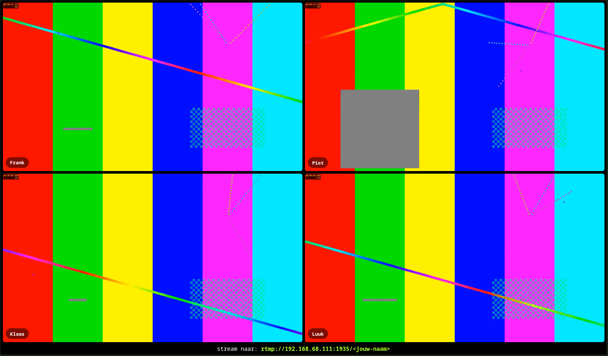

# Stroom Muur

Een simpele applicatie om meerdere RTMP streams op een scherm te tonen, bijvoorbeeld tijdens een LAN party.



## Features

- 🔧 Instelbare maximale hoeveelheid streams.
- 📐 Automatische layout voor maximale video-grootte.
- ⚡ Low-latency RTMP streaming.

## Installatie

```bash
npm install
```

## Configureren

Maak een kopie van de voorbeeldconfiguratie:

```bash
cp src/config.example.ts src/config.ts
```

Pas vervolgens `config.ts` naar wens aan.

## Starten

```
npm run start
```

Na het starten krijg je de URLs te zien waarop de website en stream server draaien.

### Bekijken

Om de streams te bekijken open je de _Web_ URL in je browser.

### Streamen

Om naar de muur toe te streamen start je een _RTMP_ stream (met bijvoorbeeld OBS Studio) naar het in de console aangegeven adres. Het pad is vervolgens je naam, bijvoorbeeld: `rtmp://127.0.0.1:1935/jouw-naam`

## Testen

Om een test-stream naar de muur te sturen gebruik je `./test.sh`, eventueel gevolgd door een adres. Als je het adres niet meegeeft wordt er naar _localhost_ gestreamt met de naam "test".
